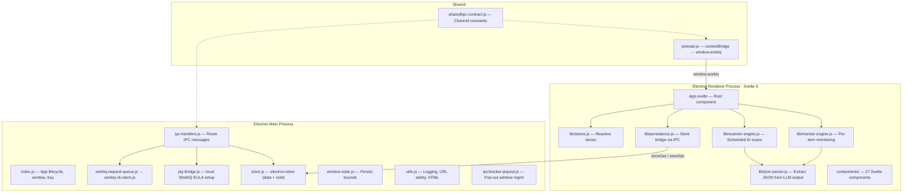
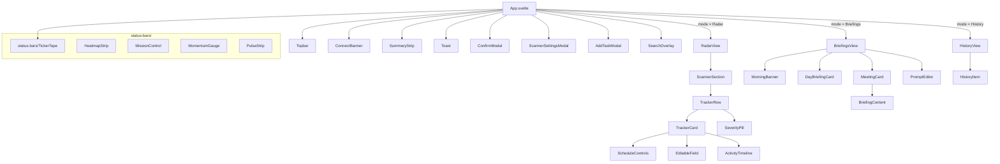
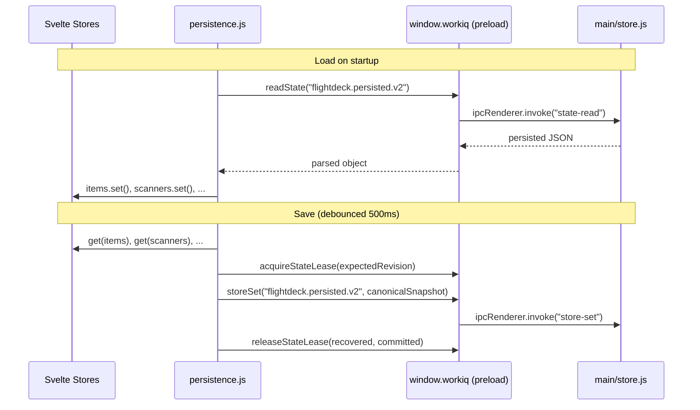
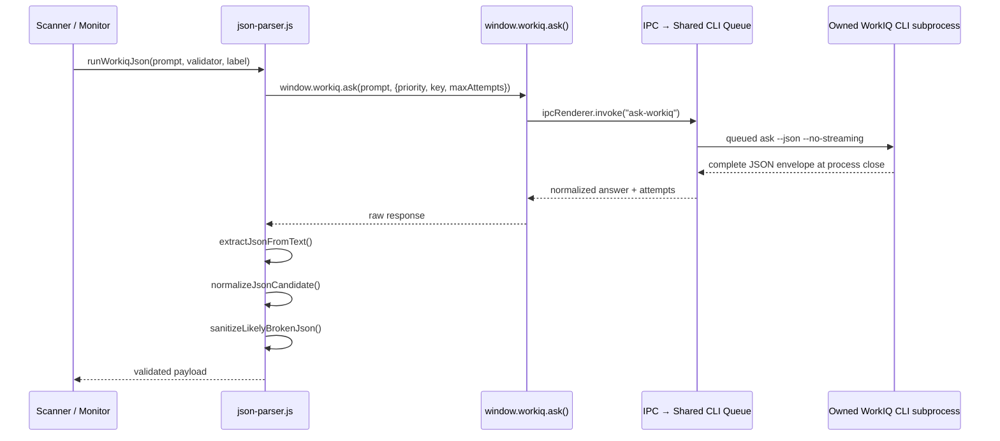
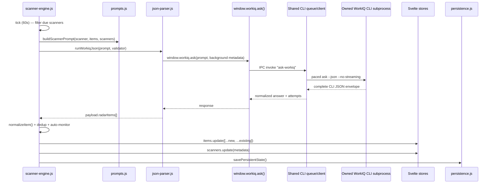
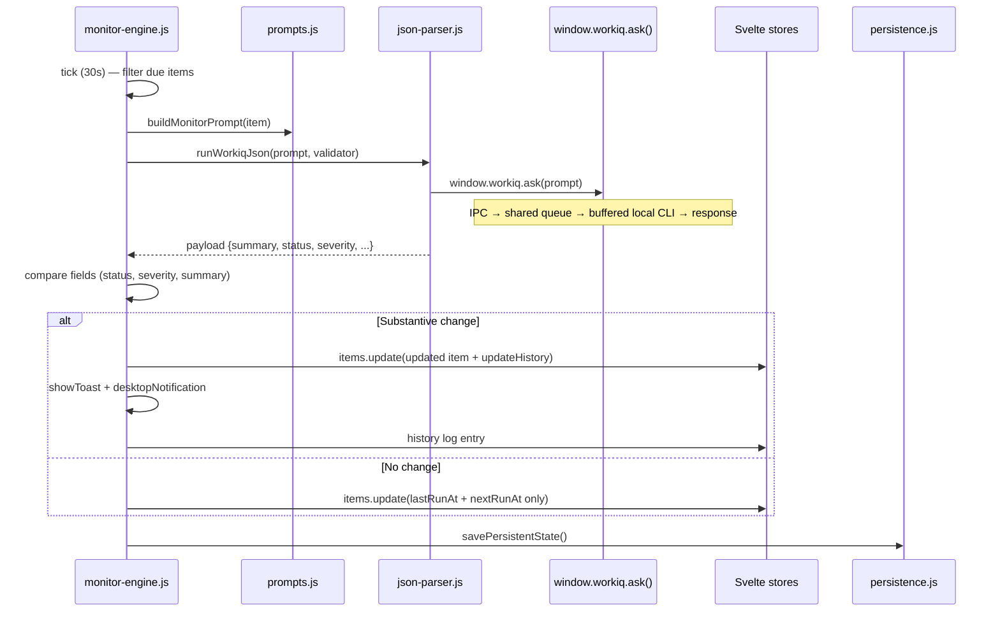
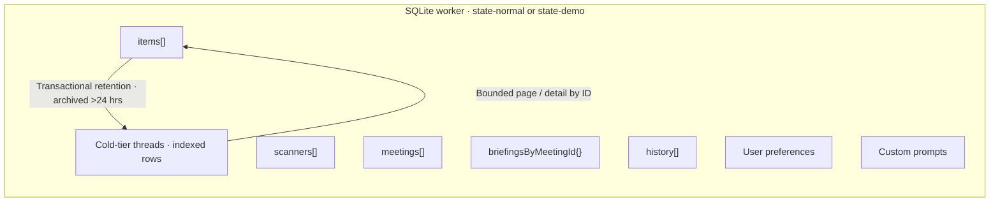

# FlightDeck Architecture

This document describes the internal architecture of FlightDeck for developers working on the codebase.

---

## System Overview

FlightDeck is an Electron desktop application with a strict two-process architecture. The **main process** manages the OS window, tray, persistence, and a shared queue feeding local WorkIQ CLI subprocesses for semantic queries and structured operations. The **renderer process** runs a Svelte 5 SPA with reactive stores, background engines, and IPC-bridged persistence.

---

## Main Process

### App Lifecycle (`src/main/index.js`)

- Creates the main `BrowserWindow` with context isolation and CSP.
- Restores saved window state (position, size, maximized).
- Creates a system tray icon with "Open" and "Quit" menu items.
- Minimizing or closing the window **hides it to the tray** — the app stays alive for background monitoring.
- `window-all-closed` is intentionally a no-op.
- Only tray menu "Quit" or `app.quit()` terminates the process.

### IPC Handlers (`src/main/ipc-handlers.js`)

All renderer↔main communication flows through named IPC channels defined in `shared/ipc-contract.js` and exposed via `preload.js`. Pop-out window IPC is extracted into `src/main/ipc/tracker-popout.js`.

| Channel | Direction | Purpose |
|---|---|---|
| `get-app-version` | Renderer → Main | Return the app version string |
| `check-for-updates` | Renderer → Main | Check GitHub Releases for a newer version |
| `ask-workiq` | Renderer → Main | Queue a buffered local CLI `ask --json --no-streaming` read |
| `accept-workiq-eula` | Renderer → Main | Enable/Retry: accept the local WorkIQ EULA via PTY |
| `read-prompt-file` | Renderer → Main | Load a markdown prompt template from `src/prompts/` |
| `open-markdown-window` | Renderer → Main | Open rendered markdown in a new window |
| `open-tracker-popout` | Renderer → Main | Pop out a tracking item into its own window |
| `open-external` | Renderer → Main | Open a URL in the system browser (with validation) |
| `show-desktop-notification` | Renderer → Main | Display an OS-level notification |
| `store-get` | Renderer → Main | Read a key from electron-store |
| `store-set` | Renderer → Main | Write a key/value to electron-store |
| `store-delete` | Renderer → Main | Delete a key from electron-store |
| `store-get-all` | Renderer → Main | Return all store contents |
| `store-get-size` | Renderer → Main | Return file size of the store on disk |
| `store-migrate-from-localstorage` | Renderer → Main | One-time migration from localStorage |
| `store-get-cold-items` | Renderer → Main | Read archived items from cold storage |
| `store-set-cold-items` | Renderer → Main | Write archived items to cold storage |
| `tracker-state-changed` | Renderer → Main (broadcast) | Notify all windows that shared state changed |
| `tracker-state-sync` | Main → Renderer | Tell a window to reload state |
| `notification-clicked` | Main → Renderer | Forward notification click for navigation |

### WorkIQ CLI Queue (`src/main/workiq-request-queue.js`)

Inbox Email and Teams composition both render inline on the source thread. Email uses the persisted action proposal as its editing/execution state; closing the editor only hides it. `outlook-draft.js` is the shared execution controller for the inline editor and Actions: it claims the proposal before awaiting, records explicit inline review transitions, invokes the existing confirmed Outlook-draft IPC, and applies the same verified outcome/audit handling. Cancelled or definitively undispatched drafts may be edited again, invalidating the old review. Executing, successful, and unconfirmed operations cannot be edited or duplicated. Outlook creation never sends email.

- All WorkIQ requests share one main-process limiter across windows, including scanner/monitor reads and proposal/action calls.
- Defaults: **5 active total**, **4 background active**, **50 pending total**, **40 background pending**, with **250 ms start pacing**. The background cap leaves an interactive slot; these are application limits, not known remote service quotas.
- The main entry creates `workiq-cli-client.js` for all production operations. Generated answers use `workiq ask --json --no-streaming`; directory reads use `workiq fetch --urls`; confirmed writes use `workiq create --url --body`. Each command is a hidden, owned subprocess with literal argv (no shell), bounded UTF-8 capture and explicit exit/error handling. Production never starts `workiq mcp`.
- Enable/Retry WorkIQ accepts the local CLI EULA through `runWorkiqAcceptEula`. WorkIQ owns Microsoft sign-in, credential persistence and renewal. FlightDeck does not manage OAuth credentials or browser callbacks.
- Structured directory lookups, Outlook draft creation and Teams sends use CLI entity commands and retain their existing confirmation/receipt checks. The CLI adapter reuses the queue and operation validators in `workiq-mcp-client.js`; that module's original MCP transport remains for compatibility tests, not production. Existing IPC names containing `MCP` remain compatibility identifiers, not transport selection. This does **not** establish whether WorkIQ creates backend conversation threads.
- Scheduled work uses background priority and per-resource keys (`scanner:<id>`, `item:<id>`); manual work defaults to interactive. Keys coalesce outstanding duplicate work; renderer operation leases additionally protect the same resource.
- Throttling signals are classified explicitly; an actual server retry-after establishes shared cooldown. Safe reads, including proposal synthesis, allow at most two total attempts, shared with renderer parse recovery. Completed empty CLI answer envelopes receive bounded read-only backoff. When WorkIQ returns a valid `conversationId` with an empty answer, the retry resubmits the original question using `--conversation-id`. Conversation state is isolated per logical request and is never reused by later scans or unrelated reads. Explicit single-attempt reads do not resume. Malformed CLI envelopes and authentication failures are not retried. Ambiguous writes are not automatically replayed; existing confirmation and audit behavior remains.
- Generic scanner/monitor reads (`readTimeout`) and proposal synthesis (`semanticTimeout`) both default to a **300-second** caller timeout because grounding a draft also retrieves Microsoft 365 context. Both remain independently injectable for deterministic testing. Synthesis start, proposal count, and sanitized failure codes are logged without draft content or thread details.
- Semantic CLI output must be a strict JSON envelope with `isError: false` and a string `response`; malformed envelopes and error envelopes are never accepted as answers. Scalar answer text such as `13`, `0` and `false` remains valid. Synthesis extracts strict JSON from the answer, including answers followed by citations or wrapped in Markdown fences, then validates the same proposal schema. It does not repair malformed JSON or treat citation text as draft content.
- Caller timeouts do not prove remote completion: the owned CLI process is terminated, but its queue lease remains counted until confirmed closure. Unresolved calls are not retried. Shutdown rejects waiting work and cancels all owned CLI subprocesses, including structured reads/writes. An individual timeout does not close unrelated commands. If capacity remains stuck, **quit FlightDeck from the tray and relaunch**; hiding/reopening the window does not restart the main process.
- Monitor failures reschedule `nextRunAt` without changing `lastRunAt`, the successful-check watermark used by the next monitoring prompt. Queue-full checks remain due without adding failure history.
- `window.workiq.getWorkiqQueueStatus()` and `onWorkiqQueueStatus(callback)` expose `{ active, pending, limit, backgroundLimit, cooldownUntil }`. Topbar subscribes on mount, reads an initial snapshot, and unsubscribes on destroy; only an active cooldown creates a countdown timer. Counts describe queue execution, not resource operation leases.
- The CLI probe verifies `ask`, `fetch` and `create` support using `workiq --help`, with the bundled **1.0.1** CLI on Windows or a PATH installation on macOS/Linux. It does not prove authenticated service access. A short overlap probe does not establish a sustained throttle-safe rate.
- Investigation of the former MCP route found unfinished streaming fragments followed by complete JSON snapshots in the same tool answer. No separate progress notifications were emitted in the observed cases, even with a progress token. Forward-only extraction could mistake the final snapshot for part of an unfinished string or URL. Shared JSON extraction retains its backwards quote/escape-aware balancing for compatibility, admitting only strictly parseable complete snapshots from that pass and retaining existing workflow/synthesis validators. This does not invent a missing prefix, repair draft content, or replay writes. Truly incomplete answers still fail explicitly.
- Direct native MCP captures also include a genuinely incomplete briefing tail with no required opening fields or complete replacement snapshot. This is already incomplete in the server's final tool response, not lost by FlightDeck's pipe framing. Extraction cannot recover absent content; renderer read workflows retain their shared two-attempt budget and report failure if no valid answer arrives. Snapshot recovery mitigates the observed duplication pattern, not every upstream incomplete response.
- CLI entity JSON is passed to the existing entity validators without inventing HTTP statuses or success receipts. WorkIQ 1.0.1 create commands emit `Created (HTTP 201):` before the JSON; the adapter recognizes only this anchored framing and carries its observed status into the existing status/data receipt validator (HTTP 200 receipts are supported too). Fetch `results[]` envelopes retain their per-path statuses and errors. Draft creation requires a returned draft ID and `isDraft: true`; Teams delivery requires a matching chat, timestamp and exact message body. Malformed output, conflicting receipts, failed statuses, and error entities fail explicitly. Entity operations use a separate 60-second timeout, not the 10-second CLI availability-probe budget; uncertain writes are never automatically replayed.
- With a supplied Teams address, FlightDeck uniquely resolves the directory identity (including verified SMTP aliases), fetches `/me`, then uses confirmed `workiq create --url /chats` to open/reuse the canonical one-to-one pair or create it if needed. Microsoft Graph returns the existing chat for an existing pair. Member roles respect directory guest status. A separate direct chat read must verify the returned ID, one-to-one type, and complete matching membership before the message POST. This avoids chat-list pagination entirely for verified addresses; failed chat opening or verification never dispatches a message. Name-only resolution still requires a complete bounded lookup, filtering to one-on-one conversations before expanding members and preserving the 1 MiB transport limit. Recipient enrichment is read-only: exact directory names are preferred, followed by unique parenthesized name qualifiers; ambiguous/incomplete results and guest sign-in UPNs without a usable SMTP address are not guessed.
- Protocol and send diagnostics record sanitized reason codes and sizes, not raw responses, recipient addresses, message bodies, or tokens. Contract fixtures cover the installed schemas and observed response envelopes without executing live writes.
- Teams composer state retains the proposal's recipient address as `targetEmail`. The send IPC accepts an optional verified email alongside the display name; a supplied address is authoritative and must never fall back to a name match. The editor clears a stale address when its name is changed. Unconfirmed delivery remains a distinct thread-scoped state across navigation, blocking another send until the user explicitly acknowledges checking Teams; that acknowledgment never dispatches a write.
- Queue-status broadcasting is appwide: close-to-tray and reopening retain the subscription; it is disposed only when application teardown begins.

### PTY Bridge (`src/main/pty-bridge.js`)

The module resolves the bundled/native launcher, handles local EULA acceptance for Enable/Retry through a PTY, and executes production CLI commands through bounded child-process pipes. Semantic answers are buffered with `--json --no-streaming`. FlightDeck does not read or copy WorkIQ credentials. Authentication failures require explicit recovery rather than replaying a write.

### Window State (`src/main/window-state.js`)

- Saves `{ bounds: { x, y, width, height }, isMaximized }` to `<userData>/window-state.json`.
- Debounced (500 ms) on resize/move events to avoid excessive writes.
- On startup, restores position only if saved bounds are visible on a connected display.

### Persistent State (`src/main/state-service.js`, `state-worker.js`)

- Main owns a single SQLite worker repository per active normal/demo profile. WAL and FULL synchronization protect atomic domain commands.
- Threads, sources, scanners, exclusions, proposals, events, tombstones and preferences live in indexed tables, not whole JSON snapshots.
- Startup publishes bounded hot projections; archive navigation, history, selected detail and source identity review use repository queries.
- Global compare-and-swap revisions and local retry receipts prevent stale-window resurrection; committed commands invalidate peers.
- A main-owned engine election/resource lease prevents duplicate scheduled scans across windows.
- Legacy `flightdeck-data` / cold JSON files are validated import/recovery inputs only. Pre-import backups and an atomic activation marker prevent stale JSON resurrection.
- Small non-domain settings may still use `store.js` / electron-store. Production legacy snapshot IPC refuses domain access.
- See [state-storage.md](state-storage.md) for import refusal/recovery, query boundaries and release limitations.

### Shared IPC Contract (`src/shared/ipc-contract.js`)

- Single source of truth for all IPC channel name strings.
- Imported by main modules; the sandbox-compatible preload mirrors the channel constants, with contract tests guarding parity.
- Includes connection readiness, state revision/lease and acknowledged-flush channels alongside application IPC.

---

## Renderer Process — Svelte Architecture

The renderer is a **Svelte 5** single-page application built with Vite. The entry point (`src/svelte/main.js`) mounts the root `App.svelte` component into the DOM.

### Component Hierarchy

**27 components** live in `src/svelte/components/`. The root `App.svelte` orchestrates view switching via the `mode` store (`"Radar"` | `"Briefings"` | `"History"`), manages lifecycle (mount/destroy), and kicks off both background engines.

### Reactive Stores (`src/svelte/lib/stores.js`)

All application state lives in Svelte `writable` stores with `derived` stores for computed values. Components subscribe reactively — no manual DOM manipulation.

#### Core Stores (writable)

| Store | Type | Purpose |
|---|---|---|
| `items` | `writable([])` | All tracking/radar items (unified model) |
| `scanners` | `writable([])` | Scanner definitions |
| `meetings` | `writable([])` | Today's calendar meetings |
| `meetingsLastFetched` | `writable(0)` | Timestamp of last meetings fetch |
| `briefingsByMeetingId` | `writable({})` | Cached briefings keyed by meeting ID |
| `briefingSeenAt` | `writable({})` | Timestamps when briefings were viewed |
| `history` | `writable([])` | Chronological activity log |
| `isDemo` | `writable(false)` | Demo mode flag |

#### UI State Stores (writable)

| Store | Type | Purpose |
|---|---|---|
| `connected` | `writable(false)` | Whether local WorkIQ setup has completed and remote controls are enabled |
| `loading` | `writable(false)` | Global loading indicator |
| `mode` | `writable('Radar')` | Active view tab |
| `density` | `writable('full')` | Card display density |
| `filter` | `writable('all')` | Active item filter |
| `collapsedSections` | `writable([])` | Collapsed scanner section IDs |
| `expandedBriefingMeetingIds` | `writable([])` | Expanded briefing cards |
| `highlightedItemId` | `writable(null)` | Item to scroll-to and highlight |

#### Derived Stores

| Store | Derives from | Purpose |
|---|---|---|
| `kpis` | `items` | KPI counts: critical, elevated, observe, blocked, new, complete |
| `filteredItems` | `items`, `coldItems`, `filter` | Items filtered by lifecycle status; merges cold storage for archived view |
| `coldItems` | _(writable)_ | Cold-storage items fetched on-demand |

#### Svelte 5 Reactivity in Components

Components use Svelte 5 runes for local reactivity:

- **`$state`** — reactive local variables (e.g., `let version = $state('')`)
- **`$derived`** — computed values that auto-update when dependencies change
- **Store subscriptions** — `$storeName` auto-subscribes to writable/derived stores in `.svelte` files

### Persistence Bridge (`src/svelte/lib/persistence.js`)

Bridges Svelte stores to `electron-store` on disk via the IPC `window.workiq` API.

Key responsibilities:
- **`loadPersistentState()`** — Reads canonical/fallback state with a main revision, normalizes/prunes and publishes cache before independent connection validation. Dirty local changes prevent stale hydration. Malformed/read failures block writes rather than authorize empty fallback.
- **`savePersistentState()`** — Snapshots all store values via `get()`, writes to electron-store. Called by engines after mutations and debounced (500 ms) on UI changes.
- **`subscribePersistentState()`** — Covers all persisted domains, skips initial subscription calls and records mutations immediately; `items` is the only newly written thread array.
- **Connection** — Durable `connectionIntent` is separate from runtime `connected`/`connectionStatus`. Main coalesces validation, gates all remote IPC and invalidates readiness on disconnect/auth errors. Engines follow readiness; log/version/update checks no longer block startup setup.
- **`flushPersistentState()`** — Drains dirty generations/transactions through acknowledged writes. Main coordinates Ctrl+R/F5/menu reload, popout close and quit while IPC remains available; failures retain windows with visible retry/conflict/export controls. Unmount removes all listeners.
- **`seedDemoFixture()`** — Seeds demo data from `src/demo/fixture.json` with date-shifted timestamps into a separate `flightdeck.demo.v2` key.
- **Meetings and daily briefings** — `src/svelte/lib/briefings.js` refreshes the full local-day calendar on connection/resume and automatically generates My Day after calendar availability, reusing today's saved overview. Calendar reads are coalesced and cached for an hour, including empty days. Shared `normalizeTodayMeetings()` in `src/svelte/lib/meetings.js` retains earlier/ongoing/upcoming meetings consistently through fetch, persistence hydration, and display while preserving opaque IDs. Automatic day-generation failures are visible and manual-retryable without a focus/reconnect retry loop. Meeting briefings remain on demand.
- **Housekeeping** — `pruneHistory()` (max 200 entries / 30 days), `pruneStaleBriefings()` (past meetings), `autoArchiveCompletedItems()`, `evictToColdStorage()`.

### Scanner Engine (`src/svelte/lib/scanner-engine.js`)

Background scheduling loop for user-defined AI scanners.

| Property | Value |
|---|---|
| Tick interval | 60 seconds |
| Renderer dispatch workers | 5 (global main-process limits still apply) |
| Schedule types | interval, weekly, one-time |
| Missed-run policies | `skip`, `run-once`, `catch-up` (max 3) |
| Dedup | Canonical item ID and exact qualified source identities; candidate scanner controls cross-scanner dedup, never title similarity |
| Auto-monitor | Configurable severity threshold |

**Flow per tick:**
1. Check `connected` store — skip if WorkIQ unreachable.
2. Filter scanners where `enabled && nextRunAt <= now`.
3. Use up to five workers for due scanners, rechecking latest existence, enabled state, connection and due time before dispatch. Build prompt → `runWorkiqJson()` (background priority) → normalize items → dedup → merge into `items` store. Dedup and store mutation remain synchronous after awaited cold-store hydration.
4. Update scanner metadata (`lastRunAt`, `nextRunAt`, `itemCount`).
5. Fire desktop notifications and in-app toasts based on `notificationMode` (`all` | `critical-only` | `silent`).
6. Persist state.

Cycles cannot overlap. EULA/launcher errors disconnect and stop further deferred dispatch. `QUEUE_FULL` leaves a scanner due without advancing `lastRunAt` or recording an ordinary scan failure; a later tick can try again.

### Monitor Engine (`src/svelte/lib/monitor-engine.js`)

Background loop that checks individual tracked items for updates.

| Property | Value |
|---|---|
| Tick interval | 30 seconds |
| Renderer dispatch workers | 5 (global main-process limits still apply) |
| Schedule types | interval (15 min – 4 hr), weekly, one-time |
| Change detection | Field-level comparison (status, severity, summary) |
| History cap | 20 entries per item |

**Flow per tick:**
1. Check `connected` store — skip if WorkIQ unreachable.
2. Filter items where `monitorEnabled && nextRunAt <= now && not complete/archived`.
3. Use up to five workers, rechecking latest existence, monitoring enabled state, snooze, lifecycle, connection and due time before dispatch. Build prompt (includes last 2 summaries for dedup) → `runWorkiqJson()` (background priority). Overlapping cycles and same-resource operations are guarded.
4. Compare response fields against current values.
5. On substantive change: update item, push to `updateHistory`, set `hasNewUpdate`, fire toast + desktop notification, log to history.
6. Auto-update `lifecycleStatus` based on status keywords (resolved → complete, blocked → blocked).
7. Handle one-time schedules (disable after single run).
8. Recompute `nextRunAt` and persist state.

`QUEUE_FULL` defers scheduled monitoring without advancing timestamps or logging an ordinary failure. Manual **Run Now / Check Now** calls use interactive priority.

### WorkIQ Communication (`src/svelte/lib/json-parser.js`)

Scanner and monitor JSON reads flow through `runWorkiqJson()`:

The parser uses multiple extraction strategies (fenced code blocks, brace-delimited slicing, raw JSON start) and a multi-stage repair pipeline (ANSI stripping, Unicode quote normalization, trailing comma removal, interior quote repair), preserving citation injection and validators. It passes the remaining total-attempt budget to the backend and subtracts returned `attempts` (legacy mocks without `attempts` count as one). The default is two total attempts across network and parse retries; `maxRetries: 0` reduces this to one. Explicit backend error codes, including `QUEUE_FULL`, propagate to callers without renderer replay.

### Models (`src/svelte/lib/models/`)

Pure data-processing modules with no DOM or Svelte dependencies:

- **`item.js`** — Unified item model (radar + tracking in a single shape). Handles `normalizeItem()`, `computeNextRunAt()`, work-hours windowing, and weekly schedule logic.
- **`scanner.js`** — Scanner definition model. `createScanner()`, `normalizeScannerDefinition()`, `computeScannerNextRunAt()`.

### Utility Modules (`src/svelte/lib/`)

| Module | Purpose |
|---|---|
| `actions.js` | `addHistory()`, action execution helpers |
| `constants.js` | JSON schemas, prompt suffixes, storage keys, timing constants |
| `logger.js` | Structured logging (`logInfo`, `logWarn`, `logError`) with persistence |
| `prompts.js` | Prompt template loading via IPC, user customization, caching |
| `utils.js` | `escapeHtml()`, `normalizeExternalUrl()`, `relativeTime()`, `hashString()`, `cleanDisplayText()` |

---

## Data Flow: Scanner Execution

## Data Flow: Tracked Item Update

---

## State Persistence

### Two-Tier Storage Model

- **Active projection**: Up to 500 hot threads with compact history; only changed rows/fields are saved.
- **Cold tier**: Archived threads older than 24 hours move tiers transactionally within the same database.
- Radar pages include all matching hot/cold rows without loading the complete archive. Selected IDs can load outside the current page; Today aggregates cover all retained threads.
- Auto-archive: items in `complete` status for more than the configured `AUTO_ARCHIVE_DAYS` are automatically transitioned to `archived`.

### Housekeeping (runs on load and periodically)

| Task | Rule |
|---|---|
| History pruning | Max 200 entries, max 30 days |
| Stale briefing pruning | Briefings for past meetings removed |
| Item history cap | Max 20 action + 20 other `updateHistory` entries per item |
| Evidence link cap | Max N `evidenceLinks` per item |
| Cold eviction | Archived items older than 24 hrs moved to the indexed cold tier |

### Reload measurement boundaries

The [state diagnostics guide](state-diagnostics.md) describes the opt-in bounded
main/renderer buffers and isolated generated-profile harness. Historical JSON
baseline spans measured synchronous electron-store operations, not separate parse
and serialization phases. IPC-handler duration excludes transport/queue time;
renderer request spans include their round trip. File sizes are file-stat bytes,
not contextBridge wire bytes. No timing event writes to the engine log or state file.

Current production publishes cached projections before independently coalesced
connection validation. Historical JSON baselines had the opposite ordering.
`remote-ready` means successful existing EULA validation, not proof of subsequent
network access. Svelte tick/frame markers are opportunities, not verified usable
UI. The harness independently checks counts and completes a local interaction.
Cold application launch and warm same-main renderer reload are reported separately.

---

## Security Model

| Layer | Measure |
|---|---|
| **CSP** | `default-src 'self'; style-src 'self'; script-src 'self'` |
| **Context isolation** | Enabled — renderer cannot access Node.js APIs |
| **Node integration** | Disabled |
| **IPC surface** | Named channels exposed through `preload.js`, defined in `shared/ipc-contract.js` |
| **Context bridge** | `preload.js` exposes a minimal `window.workiq` API; no raw `ipcRenderer` access |
| **External navigation** | Intercepted and opened in system browser |
| **URL validation** | Rejects non-HTTP(S) schemes; generic M365 root URLs filtered out |
| **LLM output** | HTML-escaped before rendering; JSON parsed through sanitization pipeline |
| **WorkIQ bounds** | Shared active/pending limits, paced starts, read-attempt budget and throttling cooldown |

---

## Styles (`src/styles/`)

CSS is organized into modular files:

| File | Purpose |
|---|---|
| `tokens.css` | Design tokens (colors, spacing, typography, dark/light theme variables) |
| `layout.css` | App shell layout, toolbar, tabs, grid |
| `components.css` | Shared components (cards, pills, buttons, toasts, inputs) |
| `radar.css` | Radar/tracking item card styles |
| `tracking.css` | Tracking-specific controls (schedule selects, signal filters) |
| `scanner.css` | Scanner form, scanner section headers, advanced settings |
| `briefing.css` | Briefing cards, day-briefing, ledger |
| `search.css` | Search overlay, dropdown, result highlighting |
| `modal.css` | Confirmation modal, action drafts |

---

## Prompt Templates (`src/prompts/`)

| File | Used by |
|---|---|
| `radar-scan.md` | Default radar scan prompt — scans M365 signals, classifies by urgency |
| `briefing.md` | Meeting prep prompt — talk track, risks, follow-ups |
| `day-briefing.md` | Morning "My Day" summary prompt |
| `scanner-template.md` | Default template for new scanner prompts |

---

## Test Architecture

Tests use Node.js `node:test` runner with `node:assert`. No external test framework.

### Local WorkIQ CLI live validation

`npm run test:workiq:live` runs the actual monitor, day-briefing, scanner and proposal-synthesis prompts through the production buffered CLI client and existing response validators. Enable local WorkIQ before running it; WorkIQ owns any authentication prompts. The script runs only the CLI probe and reads (including any proposal recipient lookups), never external write operations, and does not load or modify tracked state. This test checks workflow response shapes, not a scalar count query as a proxy for JSON reliability.

### Test Helpers (`test/helpers/`)

- **`electron-mock.js`** — Module-level mocks for `electron`, `node-pty`, and `electron-store`. Intercepts `require()` calls so main-process modules can be tested outside Electron.

### Test File Naming

Test files follow the pattern `{process}-{module}.test.js`:

| Test file | Module under test |
|---|---|
| `main-ipc-handlers.test.js` | `src/main/ipc-handlers.js` |
| `main-ipc-tracker-popout.test.js` | `src/main/ipc/tracker-popout.js` |
| `main-pty-bridge.test.js` | `src/main/pty-bridge.js` |
| `main-utils.test.js` | `src/main/utils.js` |
| `main-window-state.test.js` | `src/main/window-state.js` |